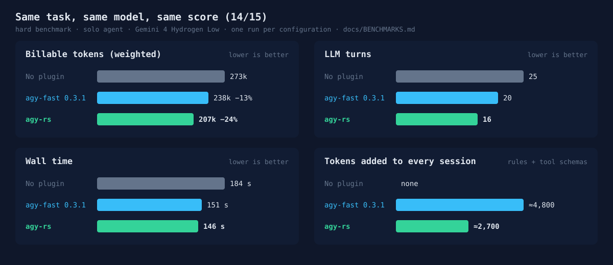

<div align="center">

# agyfast-rs

**Cut Google Antigravity token usage, agent turns and wait time — one Rust binary, no runtime**

[](LICENSE)
[](Cargo.toml)
[-38BDF8?style=flat-square&labelColor=0F172A)](#install)
[](#install)
[](#the-4-mcp-tools)

[Install](#install) · [Results](#measured-results) · [vs agy-fast](#agy-rs-vs-agy-fast) · [Tools](#the-4-mcp-tools) · [Swarm](#solo-or-swarm) · [FAQ](#faq) · [Benchmarks](docs/BENCHMARKS.md)

</div>

`agy-rs` is a local [MCP](https://modelcontextprotocol.io/) plugin for **Google Antigravity** (built
and tested with the `agy` CLI). It batches code search, reads, multi-file edits and build/test
checks into single tool calls and compresses what they return, so the agent needs fewer LLM turns
and re-reads less context. Fewer turns means lower **token usage and quota consumption**, and less
waiting. The same binary is a plain CLI, so `/swarm` workers get the same tools.

| LLM turns | Tool calls | Billable tokens (weighted) | Wall time |
| :---: | :---: | :---: | :---: |
| **−36%**<br><sub>25 → 16</sub> | **−43%**<br><sub>51 → 29</sub> | **−24%**<br><sub>273k → 207k</sub> | **−21%**<br><sub>184 s → 146 s</sub> |

<sub>Same task, same model (Gemini 4 Hydrogen Low), same score, plain Antigravity against Antigravity with `agy-rs`. One run each; method and all results in [docs/BENCHMARKS.md](docs/BENCHMARKS.md).</sub>

<p align="center">
  
</p>

## Install

**Prebuilt binary (no Rust needed).** Download the archive for your system from
[Releases](https://github.com/4funsl/agyfast-rs/releases) (macOS Apple Silicon and Intel, Linux
x86-64, Windows x86-64), unpack it, and run the installer inside:

```sh
tar -xzf agy-rs-v*-aarch64-apple-darwin.tar.gz && cd agy-rs-v*-aarch64-apple-darwin
./install.sh
```

On Windows unpack the `.zip` and run `.\install.ps1` in it. On macOS, an archive downloaded with
a browser is quarantined: run `xattr -dr com.apple.quarantine .` in the unpacked folder first.

**From source.** Requires a recent stable [Rust](https://rustup.rs) toolchain.

**macOS / Linux**

```sh
git clone https://github.com/4funsl/agyfast-rs && cd agyfast-rs
./install.sh
```

**Windows (PowerShell)**

```powershell
git clone https://github.com/4funsl/agyfast-rs; cd agyfast-rs
.\install.ps1
```

Either way the installer puts the plugin in `~/.gemini/config/plugins/agy-rs`
and copies the CLI to `~/.local/bin`. Start a new Antigravity session and confirm with
`agy plugin list`.

> [!NOTE]
> **Windows:** build and test commands run through `sh`, so [Git for Windows](https://gitforwindows.org)
> must be on `PATH`. The PowerShell scripts are new and have not been run on a Windows machine
> yet — please open an issue if something fails. `.\build.ps1 -Check` builds and runs the tests
> without installing.

## Why Antigravity sessions get slow and expensive

Every LLM turn re-reads the whole conversation, and everything a tool printed stays in that
conversation until the session ends. Three habits make this costly:

| Habit | What it costs | What `agy-rs` does |
| :--- | :--- | :--- |
| One small action per turn (a grep, then a read, then another read) | Each turn re-sends the context: about 7k weighted tokens per turn in our runs, before the turn does anything | Up to 20 searches, 40 outlines or 50 file edits in **one** call |
| Reading whole files to find one function | File reads were 70–79% of everything tools returned | A search hit can return its **whole enclosing definition**; `file#Name` reads a definition by name |
| Raw compiler and test output | Thousands of lines kept in context for the rest of the session | Build, test and lint output is reduced to **failures and a summary** |

Every result is capped at 8,800 bytes and shared fairly between the items of a batch, so nothing
spills to disk and no single result crowds out the rest.

## The 4 MCP tools

| Tool | One call does | Notable |
| :--- | :--- | :--- |
| **`batch_search`** | 1–20 text, regex, glob, fuzzy-path or read-only `git` queries, concurrently | Source files before docs; `definition: true` returns each hit with its enclosing function or type |
| **`quick_outline`** | Symbols and line ranges for up to 40 files | Rust, TypeScript/JavaScript, Python, Go, JSON/TOML/YAML, Markdown; `file#Name` returns that definition's source |
| **`apply_edits`** | Exact-match edits or new files across up to 50 files, then an optional `verify` command | Atomic and file-locked; a target that matches more than once is rejected, never applied to every match |
| **`run_checks`** | 1–12 build, test or lint commands concurrently, with timeouts | Output compressed to errors and a summary; `&&` chains run in order |

A `SessionStart` hook also gives the agent a short snapshot of the workspace (git state, layout),
so it does not spend its first turns on `ls` and `git status`.

From a shell or a swarm worker the same tools are `agy-rs cli search | outline | slices | edit |
check` — see `agy-rs cli --help`.

## Measured results

Headless Antigravity runs on two benchmark tasks from this repository, scored automatically. Costs
are compared only between runs that reached the same score. "Cost" is weighted tokens:
`output × 5 + input + cached input × 0.1`.

**Solo agent, hard task** (finish a half-done migration and add a feature across four tools):

| | No plugin | agy-fast 0.3.1 | **agy-rs** |
| :--- | ---: | ---: | ---: |
| Score | 14/15 | 14/15 | **14/15** |
| Wall time | 184 s | 151 s | **146 s** |
| LLM turns | 25 | 20 | **16** |
| Tool calls | 51 | 28 | **29** |
| Cost | 273,176 | 238,088 | **206,669** |
| vs no plugin | — | −13% | **−24%** |

On Gemini 4 Hydrogen Medium the same task gave −15% cost and 5 fewer turns against no plugin.

### agy-rs vs agy-fast

[agy-fast](https://github.com/INK-Q/agy-fast) is a TypeScript plugin for Antigravity with a similar
tool set. Its own README reports −33.7% LLM turns and −31.5% estimated quota per logical action
across its authors' real sessions. Those are its numbers, measured its way; they are not directly
comparable with a same-task test. In ours, on the identical task and model:

<p align="center">
  
</p>

| | agy-fast 0.3.1 | **agy-rs** |
| :--- | ---: | ---: |
| Runtime needed | Node.js ≥ 20 | **none** (one native binary) |
| Cost vs plain Antigravity | −13% | **−24%** |
| LLM turns | 20 | **16** |
| Tokens added to every session (rules + schemas) | about 4,800 | **about 2,700** |
| Build/test output compressed in that run | no (agent used the plain shell) | **yes** |
| Read a whole definition from a search hit | not documented | **yes** |
| Same tools available to `/swarm` workers | via `node … --cli` | **via the same binary** |

Both plugins beat plain Antigravity. `agy-rs` came out 13% cheaper than agy-fast in this run, with
4 fewer turns. That is one run of each, and the gap is about the size of run-to-run variation; the
structural rows (no runtime, less fixed context) do not depend on a run.

### Solo or swarm

**Long task** (three independent importers to diagnose and repair), Hydrogen Low:

| | Solo, agy-rs | **3-worker swarm, agy-rs** | 3-worker swarm, no plugin |
| :--- | ---: | ---: | ---: |
| Score | 36/36 | **36/36** | 36/36 |
| Wall time | 259 s | **212 s** | 280 s |
| Cost | 417,220 | 568,987 | 626,135 |

- **Independent parts:** a swarm with `agy-rs` finished 18% sooner than one agent, for 36% more
  tokens. Without the plugin the swarm was *slower* than a single agent.
- **Parts that share one contract:** a swarm cost about twice a single agent and was no faster.
  Use one agent for that kind of change.

Antigravity does not pass plugins to swarm workers. `agy-rs cli worker-brief` prints a short
brief for the coordinator to paste into worker prompts; the plugin's rules tell it to.

### Why the gain should grow on long sessions

These benchmarks take three to five minutes. The saving in them comes from fewer turns and less
re-read context (549k cached tokens against 825k), and both scale with session length: a turn
avoided when the context is 150k tokens saves far more than one avoided at 30k, and a tool result
kept small stays small for every later turn. So we expect a larger advantage on real, long
sessions than in these short tests. This is an expectation from how the cost is built, not yet a
measurement.

### How far to trust these numbers

- One run per configuration; repeating an identical run moved cost by about 11%.
- Two tasks, both on this project's own Rust code.
- One model family (Gemini 4 Hydrogen, Low and Medium).

The full method, every table, and the experiments that did **not** help are in
[docs/BENCHMARKS.md](docs/BENCHMARKS.md).

## FAQ

### How do I reduce Antigravity token usage?
Token usage in an agent session is driven by the number of LLM turns and by how much tool output
accumulates in context. Batch actions into fewer turns, read definitions instead of whole files,
and keep build output short. `agy-rs` does these three things through four MCP tools; in our tests
that cut weighted tokens by 15–24% at the same result. Using a lower effort level helped
separately: Hydrogen Low reached the same score as Medium for 25–30% less.

### Why is my Antigravity agent slow?
Mostly round trips. Each turn has a fixed latency before any work happens, and agents often spend
turns on single greps, single reads and re-running tests. Fewer, larger tool calls remove those
round trips: the same task took 16 turns with `agy-rs` against 25 without.

### Does it replace Antigravity's built-in tools?
No. Built-in `read_file` and `edit_file` stay available and the agent still uses them. The plugin
adds batched alternatives and routing rules that tell the agent when each is cheaper.

### Does it work with `/swarm` and subagents?
Yes, through the CLI. Workers do not receive MCP plugins, so the coordinator pastes the output of
`agy-rs cli worker-brief` into their prompts. See [Solo or swarm](#solo-or-swarm) for when a swarm
is worth its extra tokens.

### Does it work with Claude Code?
Optional hooks and rules are in [`claude/`](claude/README.md). In our tests Claude Sonnet already
worked in few, large steps and the hooks changed nothing measurable, so we do not claim a benefit
there.

### Does it send my code anywhere?
No. It is a local stdio process that makes no network calls of its own and has no telemetry. `git` queries through
`batch_search` are restricted to a read-only allowlist.

### Which languages does it understand?
Search, edits and checks are language-agnostic. Outlines and read-by-name use tree-sitter grammars
for Rust, TypeScript/JavaScript, Python, Go, JSON, TOML, YAML and Markdown headings; cargo, common
test runners and linters have dedicated output compressors.

### How do I uninstall it?
`agy plugin disable agy-rs`, then delete `~/.gemini/config/plugins/agy-rs` and
`~/.local/bin/agy-rs`.

## Development

```sh
cargo test                  # unit and integration tests
cargo clippy --all-targets  # must be clean
cargo run -- cli --help     # CLI syntax
python3 assets/make-demo.py && python3 assets/make-compare.py  # regenerate the README graphics
```

`src/mcp/` is the stdio JSON-RPC server and tool schemas, `src/cli.rs` the CLI, `src/core/` the
byte budget, file locks and working-directory guard, `src/tools/` one file per tool, `queries/`
the tree-sitter outline queries, `plugin/` the Antigravity bundle, `claude/` the Claude Code hooks
and rules.

## License

MIT — see [LICENSE](LICENSE).

<sub>Keywords: Google Antigravity plugin, Antigravity CLI (`agy`), reduce Antigravity token usage,
Antigravity quota, Gemini agent latency, MCP server in Rust, batch code search, tree-sitter
outline, multi-file atomic edits, compressed cargo test output, Antigravity swarm workers.</sub>
